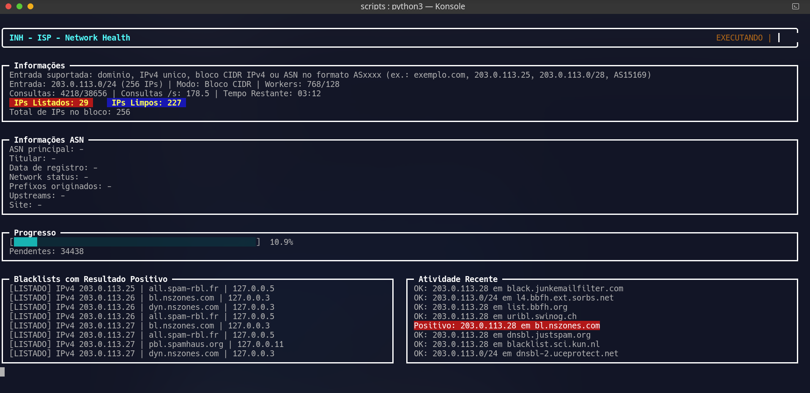
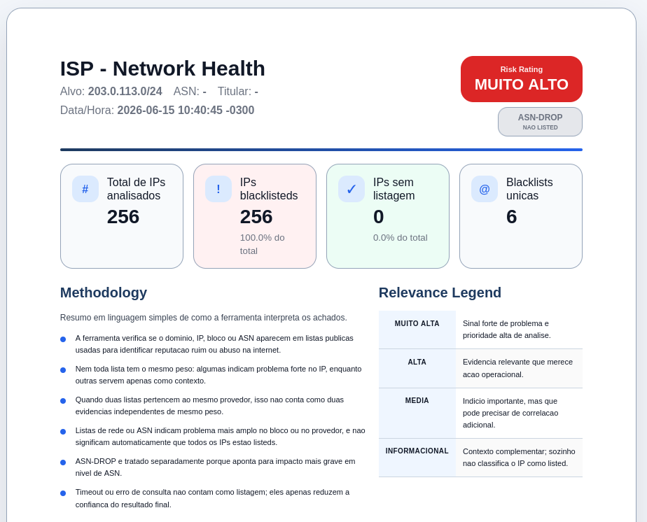
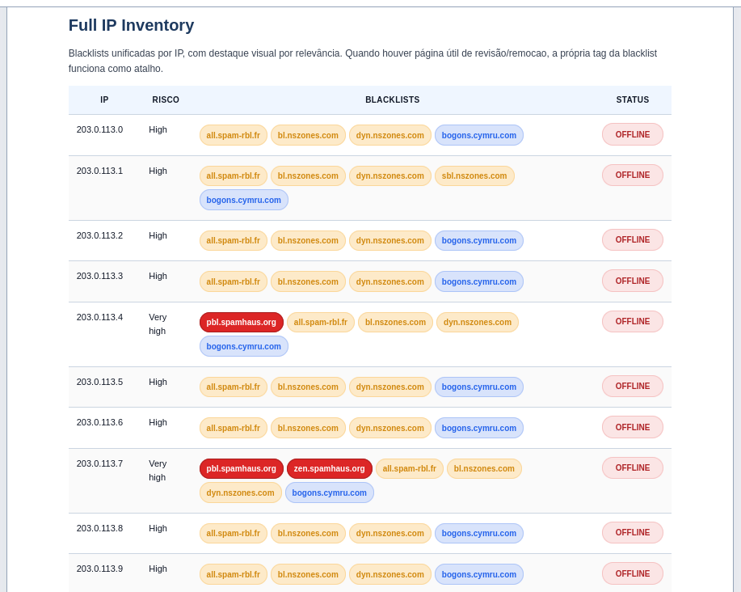

<!--
Copyright (C) 2026 Guilherme Campos
SPDX-License-Identifier: GPL-3.0-or-later
-->

# INH - ISP Network Health

INH - ISP Network Health is a CLI tool for blacklist and DNSBL analysis of domains, single IPv4 addresses, IPv4 CIDR blocks, and ASNs.  
It helps ISP/MSP operations identify listed IPs, evaluate blacklist concentration by provider family, and generate complete HTML and JSON reports.

**Author:** Guilherme Campos  
**LinkedIn:** https://www.linkedin.com/in/guilherme-campos353/

To report bugs or suggest improvements, open an [issue](https://github.com/guicampos21/INH/issues).

---

## 📋 How to Use

### 1. Clone the repository

```bash
git clone https://github.com/guicampos21/INH.git
cd INH
```

### 2. Run the launcher

```bash
./scripts/inh --help
```

### 3. Run a first scan

```bash
./scripts/inh AS15169
```

### 4. Test an IP

```bash
./scripts/inh 203.0.113.25
```

### 5. Test a CIDR block

```bash
./scripts/inh 203.0.113.0/24 --approach aggressive
```

### 6. Follow the interactive prompts

During startup, the application can ask for:
- Analysis target
- Query approach
- Full IP inventory preference
- Turbo mode
- Interface/report language (`pt-BR` or `en-US`)

### 7. Review the generated reports

At the end of the scan, the tool generates:
- Complete HTML report
- JSON summary
- Per-IP risk classification
- Family/provider deduplication
- Network probe response information

---

## ✨ Features

- ✅ Direct, network-scope, and informational blacklist separation
- ✅ ASN-DROP handling as a critical ASN/network signal
- ✅ Per-IP risk classification with textual reason and confidence
- ✅ Report-wide risk classification with structured explanation
- ✅ Blacklist family/provider deduplication to avoid artificial score inflation
- ✅ HTML and JSON output for operational use
- ✅ Full readable Python source in runtime
- ✅ Bilingual CLI and report support (`pt-BR` and `en-US`)
- ✅ Print/PDF-friendly report formatting

---

## 📈 Output

The reports can include:
- Executive summary
- Risk classification
- AS and routing information
- Full IP inventory
- Network probe response
- Detailed blacklist evidence
- Execution metadata

Generated artifacts are saved locally after each scan.

---

## 🖼️ Screenshots

The images below are demonstrative examples built with RFC 5737 documentation IP ranges. They do not expose real scan data.

### CLI execution



### HTML report summary



### IP inventory and evidence



---

## 📚 Documentation

- [Usage](docs/usage.md)
- [Architecture](docs/architecture.md)
- [Risk model](docs/risk-model.md)

---

## 📄 License

This project is licensed under the **GNU General Public License v3.0 or later**.

### What this means

- ✅ You can use, modify, and distribute this software
- ✅ Any fork or derivative must remain under the same license
- ✅ Attribution to the project author must be preserved
- ✅ Source code must remain available under GPL terms

See [LICENSE](LICENSE) and [AUTHORS](AUTHORS) for details.
