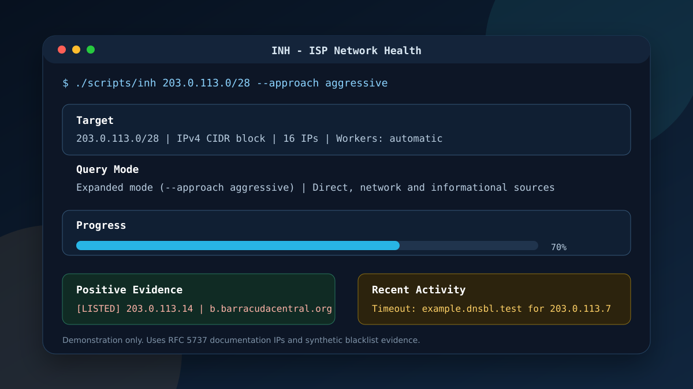
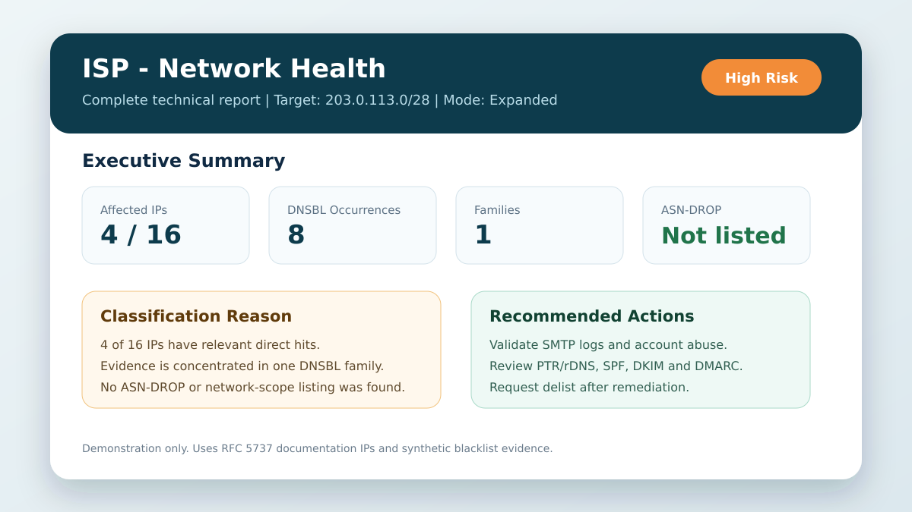
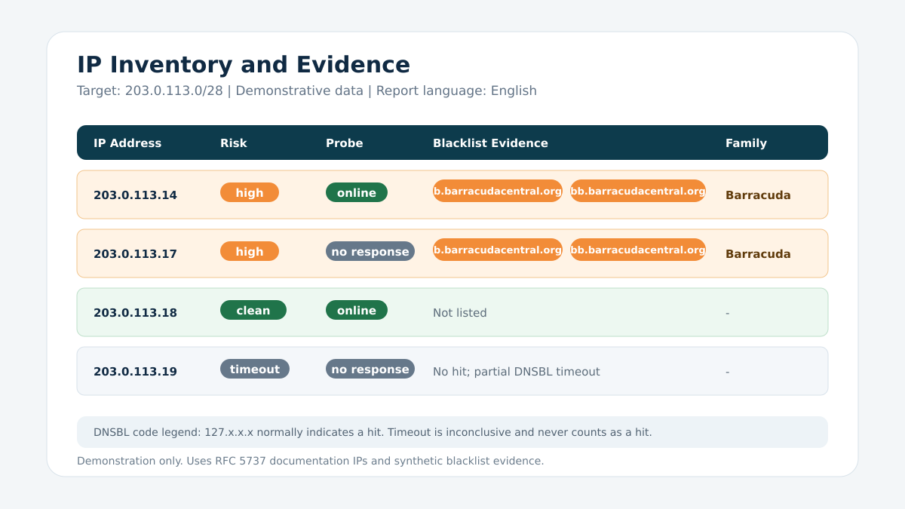

<!--
Copyright (C) 2026 Guilherme Campos
SPDX-License-Identifier: GPL-3.0-or-later
-->

# INH - ISP Network Health

[English](README.md) | **Português**

O INH - ISP Network Health é uma ferramenta CLI para análise de blacklists e DNSBLs em domínio, IPv4 único, bloco CIDR IPv4 e ASN.  
Ela ajuda operações de ISP/MSP a identificar IPs listados, avaliar concentração por família/provedor de blacklist e gerar relatórios completos em HTML e JSON.

**Autor:** Guilherme Campos  
**LinkedIn:** https://www.linkedin.com/in/guilherme-campos353/

Para reportar bugs ou sugerir melhorias, abra uma [issue](https://github.com/guicampos21/INH/issues).

---

## 📋 Como usar

### 1. Clonar o repositório

```bash
git clone https://github.com/guicampos21/INH.git
cd INH
```

### 2. Executar o launcher

```bash
./scripts/inh --help
```

### 3. Fazer o primeiro scan

```bash
./scripts/inh AS15169
```

### 4. Testar um IP

```bash
./scripts/inh 203.0.113.25
```

### 5. Testar um bloco CIDR

```bash
./scripts/inh 203.0.113.0/24 --approach aggressive
```

### 6. Responder aos prompts interativos

No início da execução, a aplicação pode perguntar por:
- Alvo da análise
- Estratégia de consulta
- Preferência de inventário completo de IPs
- Modo turbo
- Idioma da interface e do relatório (`pt-BR` ou `en-US`)

### 7. Revisar os relatórios gerados

Ao final do scan, a ferramenta gera:
- Relatório HTML completo
- JSON summary
- Classificação de risco por IP
- Deduplicação por família/provedor
- Informações de resposta a probes de rede

---

## ✨ Funcionalidades

- ✅ Separação entre blacklists diretas, de escopo de rede e informacionais
- ✅ Tratamento de ASN-DROP como sinal crítico de ASN/rede
- ✅ Classificação de risco por IP com motivo textual e confiança
- ✅ Classificação de risco geral com explicação estruturada
- ✅ Deduplicação por família/provedor para evitar inflação artificial do score
- ✅ Saída em HTML e JSON para uso operacional
- ✅ Runtime com fonte Python legível
- ✅ Suporte bilíngue na CLI e no relatório (`pt-BR` e `en-US`)
- ✅ Relatório preparado para impressão e exportação em PDF

---

## 📈 Saída

Os relatórios podem incluir:
- Resumo executivo
- Classificação de risco
- Informações de AS e roteamento
- Inventário completo de IPs
- Resposta a probes de rede
- Evidências detalhadas de blacklist
- Metadados de execução

Os artefatos gerados são salvos localmente ao final de cada execução.

---

## 🖼️ Capturas de tela

As imagens abaixo são exemplos demonstrativos criados com faixas de IP reservadas para documentação pela RFC 5737. Elas não expõem dados reais de varredura.

### Execução na CLI



### Resumo do relatório HTML



### Inventário de IPs e evidências



---

## 📚 Documentação

- [Uso](docs/usage.md)
- [Arquitetura](docs/architecture.md)
- [Modelo de risco](docs/risk-model.md)

---

## 📄 Licença

Este projeto está licenciado sob a **GNU General Public License v3.0 ou posterior**.

### O que isso significa

- ✅ Você pode usar, modificar e distribuir este software
- ✅ Qualquer fork ou derivado deve permanecer sob a mesma licença
- ✅ A atribuição ao autor do projeto deve ser preservada
- ✅ O código-fonte deve continuar disponível sob os termos da GPL

Veja [LICENSE](LICENSE) e [AUTHORS](AUTHORS) para os detalhes.
