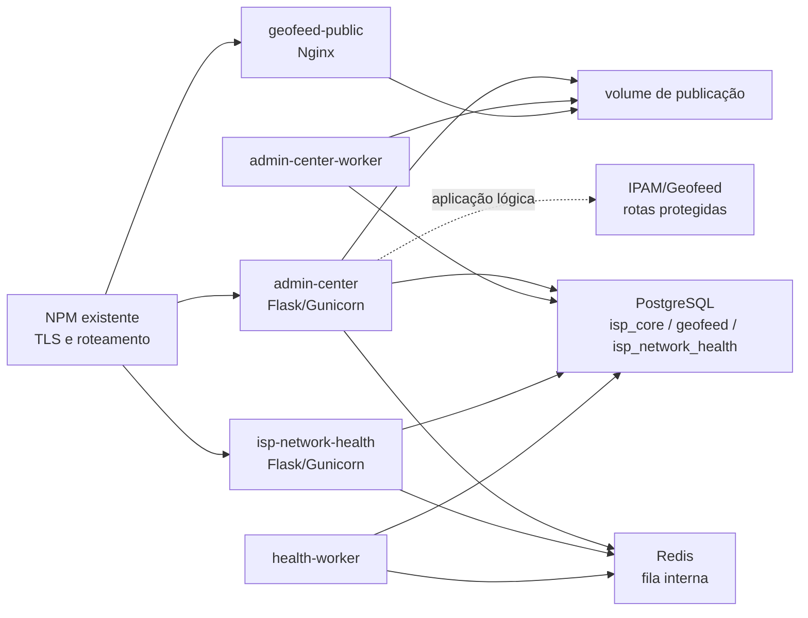

# Arquitetura

O monorepo mantém o Geofeed público, o Admin Center, a aplicação IPAM/Geofeed e o ISP Network Health sobre um cluster PostgreSQL com bancos lógicos por contexto. O Geofeed público não recebe credenciais do banco. O Admin Center é a autoridade de identidade, autorização, publicação e cadastros mestres de Empresas, Clientes e POPs/DCs; o IPAM/Geofeed compartilha esse serviço para preservar a autenticação e o fluxo atual enquanto mantém apenas suas tabelas operacionais. O ISP Network Health tem web e worker próprios.

## Limites de cada aplicação

### Geofeed público

O container contém HTML, configuração Nginx e o volume aprovado montado como somente leitura. Aceita apenas GET e não possui sessão, banco ou endpoint administrativo.

### Admin Center

O código recuperado do portal Geofeed continua sendo a base do Admin Center. O banco autoritativo inicial é `isp_core`, pois identidade, configurações, autorização e domínio Geofeed compartilham a mesma sessão SQLAlchemy.

### IPAM/Geofeed

O IPAM/Geofeed é uma aplicação lógica protegida por entitlement próprio e acessada pelo lançador em `/ipam`. Suas alocações ficam na tabela `ipam_allocations` do banco do Admin Center e referenciam os cadastros mestres `companies`, `customers` e `pops_dcs`; esses dados operacionais não fazem parte do snapshot publicado. O Geofeed conserva o contrato atual `ip_prefix,alpha2code,region,city,postal_code`; endereço exato, GPS, cliente, POP/DC, VLAN, VRF, status, contatos e autonomia permanecem operacionais.

### ISP Network Health

O pacote `src/inh` é preservado como núcleo de regras e coleta. A web não importa o CLI para responder HTTP. O worker é a fronteira para DNSBL, RDAP, WHOIS, ping e outras probes, com timeout, validação de destino e resultados persistidos em `isp_network_health`.

## Regras para novas aplicações

Uma nova aplicação deve ficar em `apps/`, expor healthcheck interno, usar os tokens visuais compartilhados, validar entitlement no servidor, receber somente seus bancos e segredos, entrar no Compose com rede interna e proxy externo, e incluir testes, documentação e revisão de segurança. Aplicações lógicas hospedadas no Admin Center devem ter rotas próprias e tabelas separadas quando o objetivo for preservar autenticação e publicação compartilhadas.
